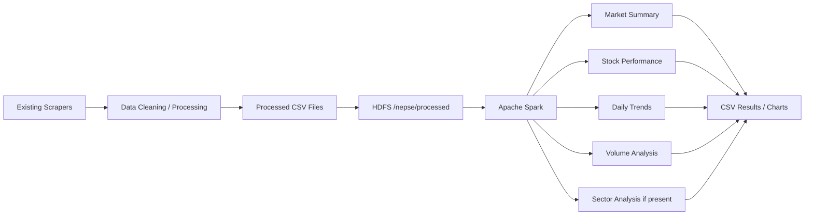

# NEPSE Big Data Analytics using Hadoop HDFS and Apache Spark

This project demonstrates how the cleaned NEPSE market data from the upstream scraper can be stored in HDFS and processed with PySpark for analytics. The goal is to keep the implementation simple, reproducible, and easy to run locally while preserving the existing scraper pipeline in the source repository.

## Project scope

The existing scraper project at /hero/projects/nepse-data already does the following:

- scrapes NEPSE data from multiple sources,
- cleans and validates the data,
- writes processed CSV files under the project’s data/processed folders.

This project adds the Big Data layer on top of those CSV outputs:

- HDFS for distributed storage
- PySpark for distributed analytics
- simple CSV outputs in HDFS and local output folders
- a few basic charts for demonstration

This project is intentionally simple and is designed for a university demonstration, not for production-scale infrastructure.

## Architecture



## Verified dataset schema

The actual cleaned CSVs in the source repo use the following schema for stock data:

- average_120_days
- average_180_days
- close
- close_ltp
- close_ltp_percent
- difference
- difference_percent
- high
- high_52_weeks
- low
- low_52_weeks
- ltp
- open
- previous_close
- range
- range_percent
- symbol
- transactions
- turnover
- volume
- vwap
- vwap_percent
- trade_date
- instrument_type
- pct_from_52w_high
- pct_vs_ma120

The index history file contains:

- trade_date
- index_id
- open
- high
- low
- close
- pct_change
- point_change
- turnover

The current processed dataset does not show a sector column, so sector analysis is included only when the source data actually contains it.

## Repository layout

```text
hadoop_analysis/
├── README.md
├── analytics/
│   ├── README.md
│   ├── scripts/
│   │   ├── upload_to_hdfs.sh
│   │   ├── download_results.sh
│   │   ├── run_demo.sh
│   │   └── visualize_charts.py
│   ├── spark/
│   │   ├── config.py
│   │   └── nepse_analytics.py
│   ├── output/
│   └── report/
│       ├── architecture.md
│       └── results.md
└── report/
    └── REPORT.md
```

## Why HDFS?

HDFS is used to store the cleaned NEPSE CSVs in a distributed storage layer. It is suitable for data that may grow over time as more historical market data is collected. In a typical Hadoop deployment, data is split into blocks and stored across multiple DataNodes while the NameNode keeps track of metadata and file placement. This makes the system easier to scale than keeping everything in a single local folder.

The project separates data into logical areas:

- /nepse/raw: raw source data, if needed
- /nepse/processed: cleaned market data that is ready for analytics
- /nepse/analytics: derived results from Spark jobs

This separation helps keep raw data, processed data, and final analytics outputs organized and easier to maintain.

## Why Spark?

Apache Spark is used for distributed processing. It works well with DataFrames, transformations, and aggregations over tabular data. In this project, Spark reads CSV files from HDFS, cleans and validates them, then computes summary tables such as:

- market summary
- stock performance
- top gainers / losers
- most traded stocks
- daily trends
- data quality metrics

Spark is especially suitable for this project because the same code can scale as the NEPSE dataset grows from a few days to many years of historical records.

## Local setup

1. Confirm Hadoop and Spark are installed locally.

```sh
hdfs version
spark-submit --version
```

2. Check the source data directory.

```sh
ls -R /hero/projects/nepse-data/data/processed
```

3. Run the full demo:

```sh
cd /hero/projects/hadoop_analysis
./analytics/scripts/run_demo.sh
```

## Demo commands

### Upload processed NEPSE CSV files to HDFS

```sh
cd /hero/projects/hadoop_analysis
./analytics/scripts/upload_to_hdfs.sh
```

### Run the PySpark analytics job

```sh
cd /hero/projects/hadoop_analysis
spark-submit --master local[*] ./analytics/spark/nepse_analytics.py
```

### Copy analytics results from HDFS to local output

```sh
cd /hero/projects/hadoop_analysis
./analytics/scripts/download_results.sh
```

### Generate charts from the output CSVs

```sh
cd /hero/projects/hadoop_analysis
python ./analytics/scripts/visualize_charts.py
```

## HDFS verification

```sh
hdfs dfs -ls -R /nepse
hdfs dfs -ls -R /nepse/processed
hdfs dfs -ls -R /nepse/analytics
```

## Expected outputs

The analytics job writes CSV outputs under HDFS:

- /nepse/analytics/market_summary
- /nepse/analytics/stock_performance
- /nepse/analytics/top_gainers
- /nepse/analytics/top_losers
- /nepse/analytics/most_traded
- /nepse/analytics/daily_trends
- /nepse/analytics/data_quality
- /nepse/analytics/sector_analysis (only if sector data exists)

The local output folder is:

- /hero/projects/hadoop_analysis/analytics/output

## Notes

- The existing scraper project is not modified.
- The analytics layer reads the already-cleaned CSV outputs.
- Sector analysis is only included when a real sector column is present; it is not fabricated.
- This project is built for demonstration, not for a complicated production pipeline.
